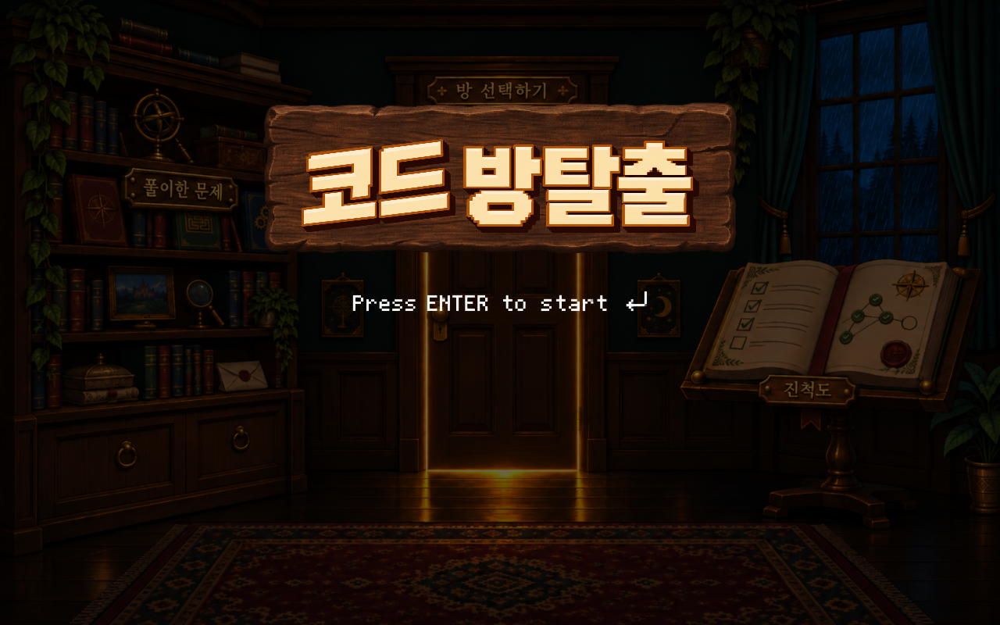

# A 대시보드 화면 설계

## 목적과 화면 흐름

로그인 성공 직후 1인칭 방탈출 대시보드로 들어간다. 첫 진입에는 제목판과 `Press ENTER to start` 안내가 나타난다. Enter를 누르면 제목이 사라지고 책장·문·일지에 접근할 수 있다. 같은 로그인 세션에서 맵 선택 화면으로부터 돌아오면 제목을 다시 표시하지 않는다.

```text
로그인 → 제목 화면 ─ Enter → 대시보드 → 문 → 맵 선택 → 게임
                              ↘ 설정 → 로그아웃 → 로그인
맵 선택 → 대시보드
```

## 화면 구성



| 영역 | 표시와 동작 |
| --- | --- |
| 배경 | 어두운 고전 게임풍 방. 문 틈에서만 빛이 나오고 문 양옆 벽등은 꺼져 있다. |
| 제목 | 별도 투명 나무판 PNG 위에 한글 게임 로고 PNG를 겹친다. `코드` 부분이 살짝 기울어진 로고이며 나무판과 로고는 각각 움직임을 줄 수 있다. |
| 시작 안내 | 제목과 분리된 `Press ENTER to start` 및 Enter 키 표시 투명 PNG를 그린다. Enter 입력 전에는 배경을 더 어둡게 하고 다른 메뉴를 숨긴다. |
| 좌측 책장 | `풀이한 문제`를 새긴 책장에 투명 클릭 영역을 둔다. 기록 서비스 연결 전에는 연동 대기 안내를 띄운다. |
| 중앙 문 | `방 선택하기`를 새긴 문에 투명 클릭 영역을 두고 맵 선택으로 연결한다. |
| 우측 일지 | `진척도`를 새긴 펼친 일지에 투명 클릭 영역을 둔다. 진척도 서비스 연결 전에는 연동 대기 안내를 띄운다. |
| 호버 | 책장·문·일지 위에 마우스를 올리면 해당 오브젝트 외곽을 밝은 금빛 선과 약한 후광으로 표시한다. |
| 창문 | 투명 GIF가 창문 안에서 반복 재생된다. 25~55초마다 불규칙하게 번개가 짧게 반짝이며 창문과 방에 반사광을 준다. |
| 좌상단 계정 | 로그인 ID 첫 글자와 실제 ID를 작은 Pretendard 글꼴로 표시한다. |
| 우상단 설정 | 회색 톱니바퀴 이미지 자체가 버튼이다. 팝업 맨 아래 `로그아웃`이 동작한다. |

배경, 나무판, 비 GIF, 번개 오버레이는 `src/main/resources/images/dashboard/`에 보관한다. 나무판, 한글 로고, 시작 안내는 모두 별도 투명 PNG이며 Java 코드는 각 이미지를 독립 레이어로 배치한다.

## 연동 경계

- `DashboardPage`는 A 담당 화면이다. 인증, 기록, 진척도, 퍼즐 규칙을 새로 구현하지 않는다.
- `AppController`와 `AppScreens`는 로그인 세션 및 로그인·대시보드·맵·게임 화면 전환을 관리한다.
- 풀이 기록은 클리어한 문제와 공개 가능한 정답만 표시해야 한다. 미클리어 정답은 노출하지 않는다.
- 진척도는 플레이 가능한 맵 수를 분모, 클리어한 맵 수를 분자로 삼고 중복 클리어를 한 번만 센다. 데이터 계약 전에는 숫자를 만들지 않는다.

## 확인 기준

1. 로그인 직후 제목 화면이 보이고 Enter를 누르면 메뉴와 계정 정보가 나타난다.
2. 책장·문·일지에 각각 호버 윤곽이 나타난다.
3. 문에서 맵 선택으로 이동한 뒤 돌아오면 제목 화면을 다시 거치지 않는다.
4. 비가 반복되고 번개는 불규칙한 긴 간격으로 잠깐만 나타난다.
5. 설정 팝업의 `로그아웃`으로 로그인 화면에 돌아간다.
6. 기록 및 진척도에는 가짜 값을 표시하지 않는다.
