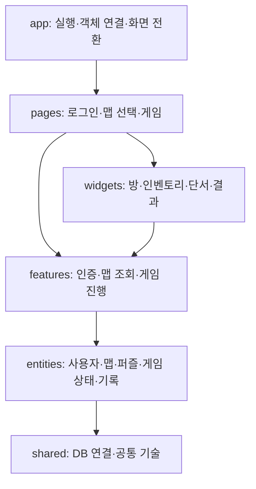
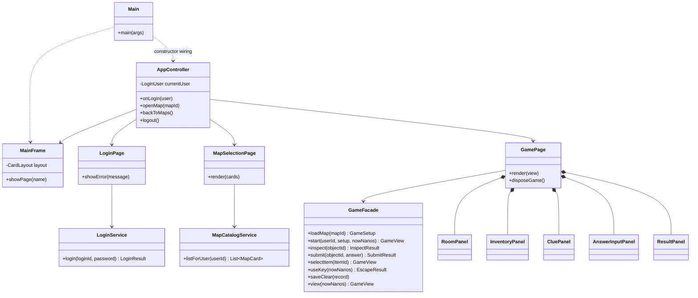
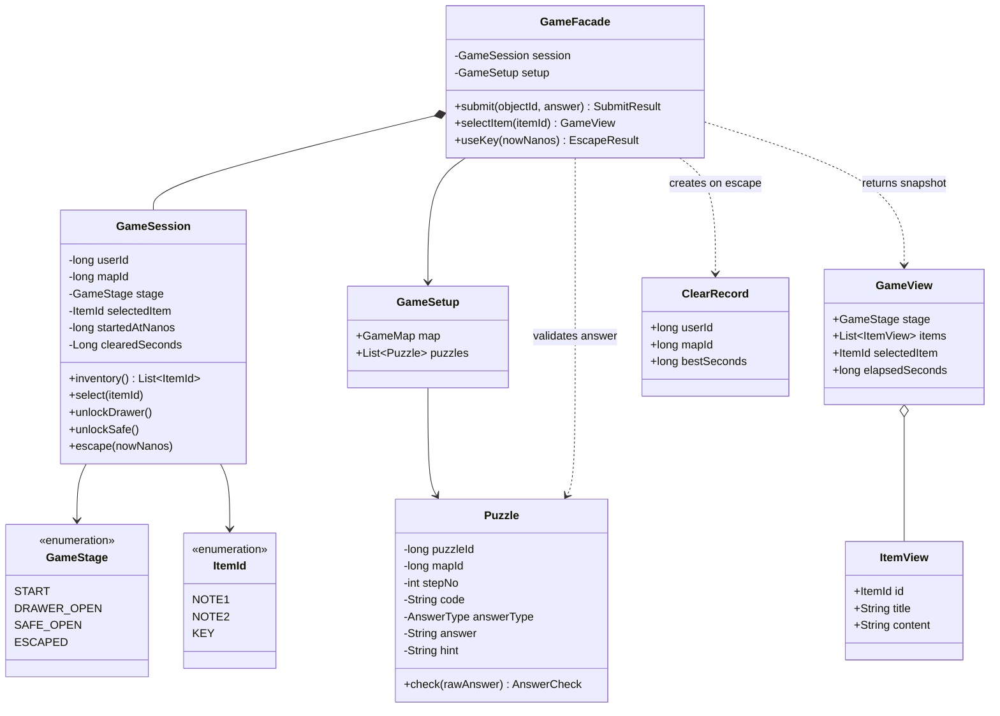
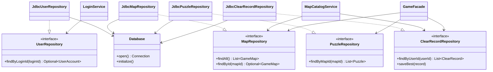
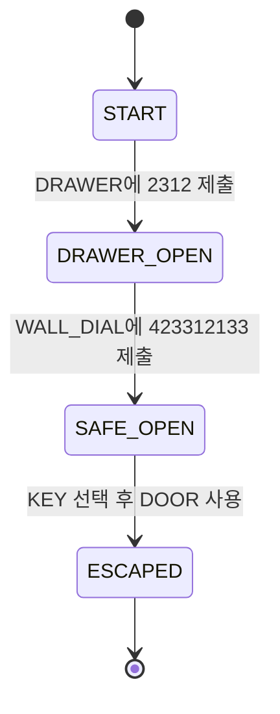
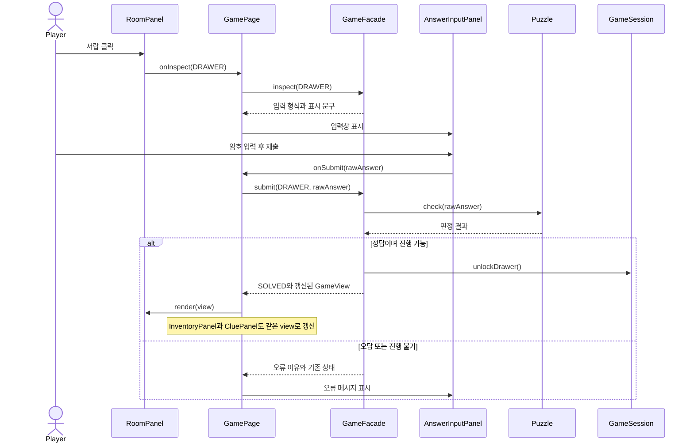

# CODE ROOM 클래스 설계 및 7인 역할 분담

이 문서는 `기획서.md`의 **로그인 → 포스터형 맵 선택 → 방탈출 → 결과 확인**을 Java Swing으로 구현하기 위한 설계안이다. 맵 1개, 퍼즐 2개, 시연 계정 3개, 데이터 4종이라는 MVP 범위를 유지한다. 아래 클래스는 구현 제안이며, 현재 존재하는 Java 클래스 목록은 아니다.

## 1. 설계 결론

- **FSD:** 파일을 책임별로 배치하고 의존 방향을 제한한다. 7명을 계층별로 배정하지 않는다.
- **Facade:** 게임 화면은 `GameFacade`를 통해 퍼즐 풀이·아이템 선택·탈출을 요청한다.
- **Adapter:** JDBC의 SQL·행 데이터를 게임에서 사용하는 저장소 인터페이스와 객체로 변환한다.
- **입력 UI:** 네 자리 입력과 3×3 다이얼은 `AnswerInputPanel`에서 형식에 따라 구성하고 제출·오류 표시는 공통으로 처리한다.
- **게임 상태:** `START`, `DRAWER_OPEN`, `SAFE_OPEN`, `ESCAPED` 네 값으로 관리한다. 상태마다 클래스를 만들지 않는다.

패턴의 개수를 늘리는 것이 목표가 아니다. 화면, 게임 규칙, 저장을 분리해 팀원들이 동시에 개발할 수 있으면 충분하다.

## 2. FSD를 Swing에 적용하는 방법

FSD의 계층과 슬라이스 개념을 Java 패키지에 맞게 적용한다. 웹 프레임워크의 폴더 형태를 그대로 복제하지는 않는다. 기본 원칙은 하위 계층 참조와 같은 계층의 다른 슬라이스 간 직접 참조 제한이다. [FSD 계층 공식 문서](https://feature-sliced.design/docs/reference/layers)



화살표는 **코드가 참조하는 방향**이다. 모든 요청이 반드시 모든 계층을 거쳐야 한다는 의미는 아니다.

| 계층 | 실제 책임 | 넣지 않을 것 |
| --- | --- | --- |
| app | `MainFrame`, `AppController`, 객체 생성·연결 | 정답 비교, SQL |
| pages | 화면 배치, 사용자 이벤트 연결, 로딩·오류 표시 | 직접 DB 접근, 게임 단계 변경 |
| widgets | 방 그림, 인벤토리, 종이, 결과 표시 | 보상 지급, 로그인 판단 |
| features | 로그인, 맵 목록 구성, 게임 진행 조율 | 화면 픽셀 좌표, DB 연결 문자열 |
| entities | 도메인 데이터·규칙, 저장소 계약과 구현 | Swing 컴포넌트, 다른 화면 이동 |
| shared | JDBC 연결과 공통 저장 오류 | 사용자·맵·퍼즐 같은 업무 모델 |

### 권장 패키지 구조

```text
coderoom/
  app/                    Main, MainFrame, AppController
  pages/
    login/                LoginPage
    mapselect/            MapSelectionPage
    game/                 GamePage
  widgets/
    room/                 RoomPanel
    inventory/            InventoryPanel
    clue/                 CluePanel
    result/               ResultPanel
  features/
    auth/                 LoginService, PasswordVerifier
    mapcatalog/           MapCatalogService, MapCard
    gameplay/             GameFacade, GameView, GameSetup, 결과 DTO
      ui/                 AnswerInputPanel
  entities/
    user/                 UserAccount, LoginUser, UserRepository, JdbcUserRepository
    map/                  GameMap, MapRepository, JdbcMapRepository
    puzzle/               Puzzle, AnswerType, PuzzleRepository, JdbcPuzzleRepository
    game/                 GameSession, GameStage, ItemId, RoomObjectId
    record/               ClearRecord, ClearRecordRepository, JdbcClearRecordRepository
  shared/
    db/                   Database, StorageException
```

`GameMap`은 Java의 `Map` 컬렉션과 구분하기 위한 이름이다. DTO는 값 전달용이며 작은 것은 관련 클래스 안의 중첩 `record`로 두어 파일 수를 줄일 수 있다. `record` 사용 여부는 팀의 JDK 버전에 맞춘다.

### 팀이 지켜야 할 의존 규칙

1. `LoginPage`가 `MapSelectionPage`를 생성하지 않는다. 로그인 성공 콜백을 받은 `AppController`가 전환한다.
2. `features.gameplay`에서 `features.auth`나 `features.mapcatalog`를 호출하지 않는다. 로그인한 사용자 ID와 선택한 맵 ID는 상위에서 전달한다.
3. `RoomPanel`이 `InventoryPanel`을 직접 고치지 않는다. 둘 다 `GamePage`가 전달하는 최신 화면 데이터로 갱신한다.
4. `entities.game`은 `entities.puzzle`을 직접 참조하지 않는다. 퍼즐 정답 판정과 게임 상태 변경을 결합하는 곳은 상위의 `GameFacade`다.
5. `ClearRecord`는 `UserAccount`·`GameMap` 객체 대신 `userId`, `mapId`만 가진다. 엔티티 사이의 순환 참조를 피한다.
6. `shared`에는 DB 연결만 둔다. `JdbcPuzzleRepository`처럼 퍼즐 모델을 아는 코드는 해당 엔티티 슬라이스에 둔다.
7. 슬라이스의 공개 진입점은 아래 클래스·메서드 목록으로 합의한다. Java의 `public`만으로 모듈 경계가 자동 강제되지는 않으므로 PR에서 import를 확인한다. 구체 JDBC 어댑터의 생성자는 앱 조립용으로 공개하고 `app.Main`에서만 사용한다.

## 3. 공평한 7인 분담안

### 작업량을 보는 기준

동일한 숙련도를 가정한 초안이다. **화면 개수나 클래스 개수로 공평함을 판단하지 않는다.** 아래 점수는 일정 확약이 아니라 업무를 비교하기 위한 상대 추정치다.

- **구현 점수:** 알고리즘·화면·리소스 제작에 드는 양과 복잡성.
- **연동 점수:** 다른 담당자의 계약을 맞추고 비동기 흐름을 연결하는 부담.
- **검증 점수:** 실패·경계 조건·시각적 동작을 확인하는 부담.
- 각 항목은 1~5점. 총점은 11~12점 수준으로 맞추고 1주 차 실제 진척으로 재배분한다.

| 담당 | 주 업무 | 구현 | 연동 | 검증 | 합계 |
| --- | --- | ---: | ---: | ---: | ---: |
| A | 앱 골격·화면 전환·게임 화면 통합 | 3 | 5 | 4 | 12 |
| B | 로그인·비밀번호 검증·사용자 저장소 | 4 | 3 | 4 | 11 |
| C | 포스터형 맵 선택·맵 조회·맵 저장소 | 4 | 4 | 3 | 11 |
| D | 방 그래픽·물건 클릭·크기 변경 대응 | 5 | 3 | 4 | 12 |
| E | 게임 규칙·상태·GameFacade | 5 | 4 | 3 | 12 |
| F | 단서·인벤토리·두 암호 입력 UI | 4 | 4 | 3 | 11 |
| G | DB 초기화·퍼즐/기록 저장·결과 표시 | 4 | 3 | 4 | 11 |

### 담당자별 소유 파일과 완료 조건

| 담당 | 소유 범위 | 구체적인 작업과 완료 조건 |
| --- | --- | --- |
| **A** | `app/*`, `pages/game/*` | `JFrame` 하나와 `CardLayout` 구성, 로그인→맵→게임 전환, 각 위젯 연결, `SwingWorker` 시작·완료 처리, 게임 종료 시 타이머 정리. 다른 사람의 위젯 내부를 대신 구현하지 않는다. 전체 흐름을 한 번 통과하는 통합 검증을 작성한다. |
| **B** | `pages/login/*`, `features/auth/*`, `entities/user/*` | 로그인 폼, 공백 입력·오류 안내, 비밀번호 검증, `UserRepository`와 사용자 SQL 구현. 정상/실패 로그인과 계정 구분 검증까지 맡는다. 해시 생성은 시연 계정 초기화에도 재사용하고 암호 알고리즘 자체를 만들지 않는다. |
| **C** | `pages/mapselect/*`, `features/mapcatalog/*`, `entities/map/*`, 포스터 리소스 | 포스터 3개 구성, 플레이 가능 1개/준비 중 2개 처리, 계정별 클리어·최고 기록 결합, 맵 조회 SQL. 기록을 불러온 뒤 포스터 표시가 갱신되고 준비 중 맵은 입장할 수 없어야 한다. |
| **D** | `widgets/room/*`, 방 배경·물건 리소스 | 전체 화면 방, 서랍·다이얼·문의 클릭 영역, 열린 상태 그림, 마우스 피드백, 화면 크기 변경에 따른 좌표 보정. 로직이나 DB는 맡지 않는다. 단서 종이에 핵심 물건이 가려지지 않는지 시각 검증한다. |
| **E** | `features/gameplay`의 로직·공개 DTO, `entities/game/*`, `entities/puzzle`의 모델·인터페이스 | `GameFacade`, `GameSession`, 퍼즐 형식/정답 판정, 진행 순서, 중복 보상 방지, 열쇠 선택 조건, 탈출 시간 확정. 실제 Swing·DB 없이 단위 검증 가능해야 한다. `gameplay/ui`와 JDBC 구현은 소유하지 않는다. |
| **F** | `widgets/inventory/*`, `widgets/clue/*`, `features/gameplay/ui/*` | 단서 교체·접기, 열쇠 표시, 네 자리/3×3 입력기, 힌트, 오답 메시지, 키보드 이동. UI는 입력을 모아 E의 API를 호출할 수 있도록 콜백만 전달한다. 정답을 UI에 별도로 적어 판정하지 않는다. |
| **G** | `shared/db/*`, `entities/puzzle/JdbcPuzzleRepository`, `entities/record/*`, `widgets/result/*`, 초기 SQL | SQLite 연결·테이블 생성·초기 데이터, 퍼즐 읽기, 최고 기록 저장/조회, 탈출 결과 패널. 저장 실패·재시도·더 느린 기록으로 덮어쓰기 방지를 검증한다. 사용자의 비밀번호 형식은 B와 계약하고 직접 별도 구현하지 않는다. |

**업무량을 맞춘 이유:** B·C는 화면만 맡으면 가벼워서 자기 기능의 저장소까지 맡긴다. D는 리소스 제작·클릭 좌표·시각 QA를 포함한다. E는 규칙이 복잡하므로 그래픽과 SQL 구현을 제외한다. F는 인벤토리뿐 아니라 두 입력기와 힌트까지 담당한다. G에게 모든 SQL을 몰아주지 않고 B·C와 나눈다. A는 통합 부담을 고려해 별도의 기능 개발을 적게 배정한다.

### 병목과 재배분 규칙

- **DB 대기 방지:** 첫날 `Database.open()`과 저장소 메서드부터 합의한다. B·C는 자기 SQL을 직접 구현하고, E는 테스트용 메모리 저장소로 진행한다. 테스트 대역은 운영 코드의 새 기능이 아니다.
- **E 대기 방지:** E가 첫날 `GameView`와 메서드 시그니처를 제공하면 D·F는 고정된 예시 데이터로 화면을 만든다.
- **A 몰림 방지:** 각 담당자가 자기 기능 검증과 PR을 마친다. A가 모든 버그를 대신 고치거나 모든 사람의 테스트를 작성하지 않는다.
- **그래픽 지연:** D의 리소스 작업이 예상보다 커지면, 포스터가 끝난 C가 방 리소스 제작을 지원한다. 게임 규칙까지 D에게 넘기지 않는다.
- **통합 지연:** 1주 차 이후 연동 작업이 몰리면 B 또는 C가 자기 기능과 연결되는 전환 테스트를 맡는다.
- **리뷰 짝:** A↔E, B↔G, C↔D를 기본으로 하고 F의 입력/단서 계약은 E, 실제 표시 연동은 A가 확인한다. 특정 한 명을 모든 PR의 필수 승인자로 두지 않는다.

## 4. 클래스 다이어그램

모든 DTO와 Swing 기본 클래스를 한 장에 넣으면 읽기 어렵다. 발표·설계에서는 아래 **전체 구조, 게임 도메인, 저장소 Adapter** 세 장으로 나누는 것을 권장한다. `..>`는 사용, `-->`는 보유 참조, `*--`는 소유, `..|>`는 인터페이스 구현을 나타낸다.

### 4.1 전체 구조



`LoginPage`에서 상위로 알릴 때는 `Consumer<LoginUser>`, 맵 선택은 `LongConsumer` 같은 생성자 콜백으로 받는다. **화면 클래스에서 `AppController`를 import하지 않는다.** 게임의 각 위젯도 콜백을 받아 이벤트만 전달하며 다른 위젯을 직접 참조하지 않는다.

### 4.2 게임 도메인과 Facade



- `GameSession`은 게임 규칙과 메모리 상태만 가진다. Swing·SQL·다른 엔티티 슬라이스를 참조하지 않는다.
- `inventory()`는 단계로부터 계산한다. 시작은 종이 1, 서랍 해제는 종이 1·2, 금고 해제 이후는 종이 1·2·열쇠다. **단계와 아이템 목록을 따로 수정해 불일치시키지 않는다.**
- `Puzzle`이 형식과 정답을 검사하고, 정답일 때만 Facade가 `GameSession`의 전이를 요청한다.
- 정답이 맞아도 현재 단계와 장치가 맞지 않으면 진행되지 않는다. `unlockDrawer()`, `unlockSafe()`, `escape()`도 자체 전제 조건을 검사한다.
- `GameView`와 `ItemView`는 읽기 전용 스냅샷이다. UI가 받은 목록을 수정해 실제 상태를 바꿀 수 없게 복사한다. 정답 필드는 포함하지 않는다.
- `ClearRecord.bestSeconds`는 저장할 후보 기록의 시간이다. 기존 최고 기록과 비교·갱신하는 책임은 저장소 구현에 있다.

### 4.3 저장소 Adapter



`Database`에 모든 테이블의 CRUD를 넣지 않는다. 연결·초기화만 담당하고, SQL과 행 변환은 각 `Jdbc...Repository`에 둔다.

## 5. 실제로 적용하는 디자인 패턴

### 5.1 Facade — GameFacade

**문제:** `GamePage`가 정답 비교, 상태 변경, 아이템 지급, 기록 저장 판단을 모두 처리하면 화면 담당과 로직 담당이 같은 파일을 계속 수정하게 된다.

**적용:** `GameFacade`를 게임 조작의 진입점으로 두고 `Puzzle`, `GameSession`, 저장소의 사용을 조율한다. Facade는 여러 하위 기능을 간단한 인터페이스로 사용할 수 있게 하는 패턴이다. [Facade 해설](https://refactoring.guru/design-patterns/facade)

| 조작 | Facade의 역할 | 다른 클래스의 역할 |
| --- | --- | --- |
| 게임 준비 | 맵·퍼즐을 읽고 플레이 가능 여부와 데이터 일관성 확인 | JDBC 처리는 Repository |
| 암호 제출 | 장치·단계를 확인하고 정답 결과에 따라 상태 변경 요청 | 정답 비교는 Puzzle, 전이 조건은 GameSession |
| 아이템 선택 | 획득한 아이템 선택을 요청하고 화면 데이터 반환 | 보유 여부 확인은 GameSession |
| 탈출 | 열쇠·단계를 확인하고 시간을 확정해 기록 후보 생성 | 상태·경과 시간은 GameSession |
| 저장 | 전달받은 불변의 기록을 저장소에 전달 | SQL·최고 기록 갱신은 Repository |

`GameFacade`에는 그림 그리기, 클릭 좌표, 비밀번호 검증, SQL을 넣지 않는다. 모든 기능을 관리하는 거대한 `GameManager`로 만들지 않는다.

### 5.2 Adapter — Jdbc...Repository

**문제:** 게임에 필요한 것은 `findByMapId(mapId)` 같은 호출이지만, JDBC는 연결·SQL·`PreparedStatement`·`ResultSet`을 다룬다.

**적용:** `JdbcPuzzleRepository` 등이 JDBC를 사용하고 결과를 `Puzzle` 같은 도메인 객체로 변환한다. 게임 쪽에서는 Repository 인터페이스만 참조한다. 서로 맞지 않는 인터페이스 사이를 변환하는 것이 Adapter의 역할이다. [Adapter 해설](https://refactoring.guru/design-patterns/adapter)

| 패턴의 구성 요소 | 이 프로젝트에서 해당하는 것 |
| --- | --- |
| Client | GameFacade / LoginService / MapCatalogService |
| Target | PuzzleRepository 등의 인터페이스 |
| Adapter | JdbcPuzzleRepository 등의 구현 |
| Adaptee | JDBC API와 SQLite의 행 데이터 |

Repository는 저장 계약, Adapter는 JDBC와의 변환 역할이라는 서로 다른 관점이다. 클래스 이름에 Adapter를 붙이는 것만으로 패턴을 적용했다고 설명하지 않는다.

### 5.3 기존 이벤트 처리 활용

Swing의 `ActionListener`와 생성자로 전달하는 콜백을 사용한다. Observer 방식의 이벤트 알림으로 설명할 수 있지만 자체 이벤트 버스나 구독 관리 클래스를 만들지는 않는다.

FSD는 코드 구성 원칙, 생성자 의존성 주입은 객체를 연결하는 방법이다. Facade·Adapter와 함께 모두 “적용한 GoF 패턴”으로 세지 않는다. Singleton, State, Abstract Factory는 사용하지 않는다.

## 6. 첫날 합의할 API와 데이터

아래는 구현 전 계약표다. 예외와 DTO의 필드까지 담당자끼리 먼저 확정해야 임시 화면과 실제 기능을 별도로 개발할 수 있다.

| 공개 API | 입력 → 출력 | 주의할 점 |
| --- | --- | --- |
| LoginService.login | loginId, char[] password → LoginResult | 성공 시 ID와 표시용 로그인 ID만 있는 LoginUser를 반환한다. 해시는 화면에 전달하지 않는다. |
| MapCatalogService.listForUser | userId → List<MapCard> | GameMap과 해당 사용자의 ClearRecord를 결합한다. |
| GameFacade.loadMap | mapId → GameSetup | 작업 스레드에서 DB 조회. 맵 존재·playable·퍼즐 2개의 순서와 형식을 검증한다. |
| GameFacade.start | userId, setup, nowNanos → GameView | EDT에서 GameSession 생성. 플레이마다 Facade도 새로 만든다. |
| GameFacade.inspect | RoomObjectId → InspectResult | 설명, 입력창 열기 지시, 선행 조건 부족을 반환한다. 진행 상태는 바꾸지 않는다. |
| GameFacade.submit | objectId, rawAnswer → SubmitResult | WRONG / INVALID / BLOCKED / ALREADY_SOLVED / SOLVED와 표시 메시지를 반환한다. |
| GameFacade.selectItem | ItemId → GameView | 미획득 아이템은 거절한다. UI는 반환값을 그린다. |
| GameFacade.useKey | nowNanos → EscapeResult | 성공 시 GameView와 ClearRecord를 반환한다. 실패 시 이유를 반환하고 상태는 유지한다. |
| GameFacade.saveClear | ClearRecord → void | 작업 스레드에서 실행. 실패는 StorageException. GameSession에는 접근하지 않는다. |
| GameFacade.view | nowNanos → GameView | 현재 상태와 경과 시간 반환. DB 조회는 하지 않는다. |

- `RoomObjectId`: `DRAWER`, `WALL_DIAL`, `DOOR`, `BOOKS`, `WINDOW`.
- `InspectResult`의 입력창용 정보는 문제 ID·형식·표시 문구다. 정답은 전달하지 않는다.
- `SubmitResult`에는 판정·메시지·최신 `GameView`를 넣는다. 사용자 오답과 저장소 장애를 구분한다.
- `MapCard`는 포스터 표시용, `GameView`는 게임 표시용 값 객체다. DB 테이블을 추가한다는 뜻이 아니다.
- UI에서 Session의 setter를 호출하지 않는다. 패널은 `render(view)`와 필요한 이벤트 콜백만 공개한다.
- 미획득 아이템 선택은 `IllegalArgumentException` 같은 규칙 위반으로 처리하고 GamePage에서 안내한다. 정상 UI는 보유한 아이템만 선택 가능하게 한다.
- 재시작은 이전 GamePage·Facade를 정리하고 같은 맵을 다시 시작한다. 별도의 재시작 서비스는 만들지 않는다.

### 상태와 해제 조건



| 상태 | 보유 아이템 | 다음 진행 동작 |
| --- | --- | --- |
| START | NOTE1 | 첫 종이를 읽고 서랍 암호 풀기 |
| DRAWER_OPEN | NOTE1, NOTE2 | 벽의 3×3 다이얼 풀기 |
| SAFE_OPEN | NOTE1, NOTE2, KEY | KEY를 선택하고 문 열기 |
| ESCAPED | NOTE1, NOTE2, KEY | 결과 확인·재시작·맵으로 돌아가기 |

오답, 미획득 아이템 선택, 순서를 건너뛴 조작에서는 상태를 바꾸지 않는다. 이미 푼 장치는 다시 눌러도 아이템을 추가로 지급하지 않는다. **게임 진행 상태와 기록 저장 상태는 별개**로 관리한다.

## 7. 호출 순서와 실패 처리

### 암호를 입력하는 흐름



### Swing 스레드 규칙

- 화면 조작과 `GameSession` 변경은 EDT에서만 처리한다.
- DB 조회·비밀번호 검증·기록 저장은 `SwingWorker.doInBackground()`에서 수행한다.
- 완료 후 `done()`에서 결과를 받아 화면을 갱신한다. UI 이벤트 안에서 작업 완료를 기다리려고 `get()`을 호출하지 않는다.
- 게임 시작은 작업 스레드의 `loadMap()` → `done()`에서 `start()` 순서다. 상태를 여러 스레드에서 동시에 변경하지 않는다.
- 탈출은 EDT에서 시간과 기록 후보를 확정하고, 불변의 ClearRecord만 저장 작업에 전달한다.
- 작업 중에는 해당 버튼과 화면 전환을 잠시 막는다. 이전 화면의 늦은 응답이 다른 사용자의 화면을 덮어쓰지 않게 한다.

Swing의 “오래 걸리는 처리는 EDT 밖, Swing 컴포넌트 조작은 EDT” 규칙에 맞춘 방식이다. [Oracle SwingWorker API](https://docs.oracle.com/en/java/javase/21/docs/api/java.desktop/javax/swing/SwingWorker.html)

### 기록 저장

1. 열쇠로 탈출한 순간 소요 시간을 확정한다. 저장 재시도 때문에 기록 시간이 늘어나지 않는다.
2. 결과 패널에 먼저 “탈출 성공 · 기록 저장 중”을 표시한다.
3. 저장에 성공하면 결과 패널에 저장 완료를 표시한다. 사용자가 맵 선택으로 돌아갈 때 해당 사용자의 기록을 다시 읽는다.
4. 실패하면 탈출 성공은 유지하고 “기록 미저장”과 재시도를 표시한다. 저장 완료로 표시하지 않는다.
5. 저장하지 않고 나가려면 기록을 잃는다는 안내를 확인받는다. 로그아웃 시 이전 사용자의 세션과 화면 데이터를 버린다.

`(user_id, map_id)` 복합 기본키와 UPSERT 한 번으로 더 짧은 기록을 유지한다. 같은 결과를 재시도해도 행이 늘어나지 않고, 느린 기록이 최고 기록을 덮어쓰지 않는다. [SQLite UPSERT 공식 문서](https://www.sqlite.org/lang_upsert.html)

```sql
INSERT INTO clear_records (user_id, map_id, best_seconds)
VALUES (?, ?, ?)
ON CONFLICT (user_id, map_id) DO UPDATE SET
    best_seconds = MIN(clear_records.best_seconds, excluded.best_seconds);
```

SQL은 PreparedStatement로 실행한다. Connection·Statement·ResultSet은 try-with-resources로 닫는다. DB 연결을 여러 스레드에서 공유하지 않고, `Database.open()`마다 외래키 제약을 활성화한다. 조회 실패를 “조회 결과 0개”로 처리하지 않는다.

## 8. 3주 개발 순서와 검증

| 기간 | A | B | C | D | E | F | G |
| --- | --- | --- | --- | --- | --- | --- | --- |
| 첫날 | 화면·콜백 계약 | 로그인 계약 | MapCard 계약 | 클릭 대상 ID | GameView·단계·조작 API | 입력·표시 콜백 | DB·저장소 계약 |
| 1주 차 | 세 화면의 임시 동선 | 정상/실패 로그인 | 포스터·임시 기록 표시 | 임시 배경·클릭 영역 | UI 없는 전체 탈출 흐름 | 임시 GameView로 단서·입력기 | 스키마·초기 데이터 |
| 2주 차 | 실제 기능을 매일 연결 | DB 연결·입력 오류 처리 | 실제 기록·맵 입장 조건 | 완성 배경·장치 상태 표시 | Facade의 조건별 처리 | 실제 코드 종이·입력 방식 2개 | 최고 기록 저장·결과 UI |
| 3주 차 | 전체 검증·실행 안내 | 계정 전환 검증 | 복귀 시 기록 갱신 | 크기 변경·시각 QA | 순서·중복·열쇠 조건 | 키보드·표시 QA | 저장 실패·재시도 QA |

| 담당 | 최소 검증 항목 |
| --- | --- |
| A | 로그인→맵→탈출→복귀→로그아웃. 재시작 시 이전 타이머가 남지 않는지 확인. |
| B | 정상 비밀번호, 틀린 비밀번호, 없는 ID, 공백 입력. 해시·비밀번호가 화면이나 로그에 나오지 않는지 확인. |
| C | 준비 중 맵 입장 차단, 미완료/클리어 표시, 사용자 전환 후 기록 변경. |
| D | 화면 물건과 클릭 영역 일치, 크기 변경, 종이 개폐 시 주요 물건 조작 가능 여부. |
| E | 정답이라도 순서가 다르면 차단, 두 번 제출해도 보상 중복 없음, 열쇠 미선택 시 탈출 차단. |
| F | 공백·자릿수 부족·숫자 외 입력, 3×3의 행 순서, 앞자리 0 유지, 아이템 선택과 표시 일치. |
| G | 같은 기록 재저장, 더 빠른/느린 기록, 사용자별 분리, DB 장애가 호출자에게 실패로 전달되는지 확인. |

로직과 저장 검증은 작은 Java 테스트로 남기고, 화면은 체크리스트로 확인한다. 테스트 전담 한 명을 만드는 대신 각 담당자가 자신의 실패 조건까지 확인한다.

## 9. 발표용 설명 예시

“FSD를 참고해 화면·기능·엔티티의 의존 방향을 나눴습니다. 게임 조작은 GameFacade로 모아 화면이 세부 진행 규칙을 몰라도 동작하게 했습니다. 저장에는 Repository 인터페이스와 JDBC Adapter를 사용해 SQL을 게임 규칙에서 분리했습니다. 게임 진행 상태는 네 단계의 enum으로 관리합니다. 7명의 역할은 구현뿐 아니라 연동·리소스 제작·테스트 부담을 포함해 분배했습니다.”
