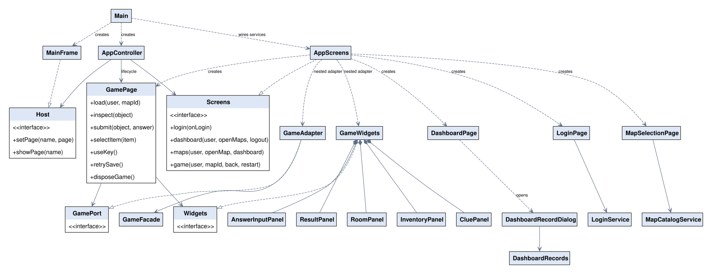
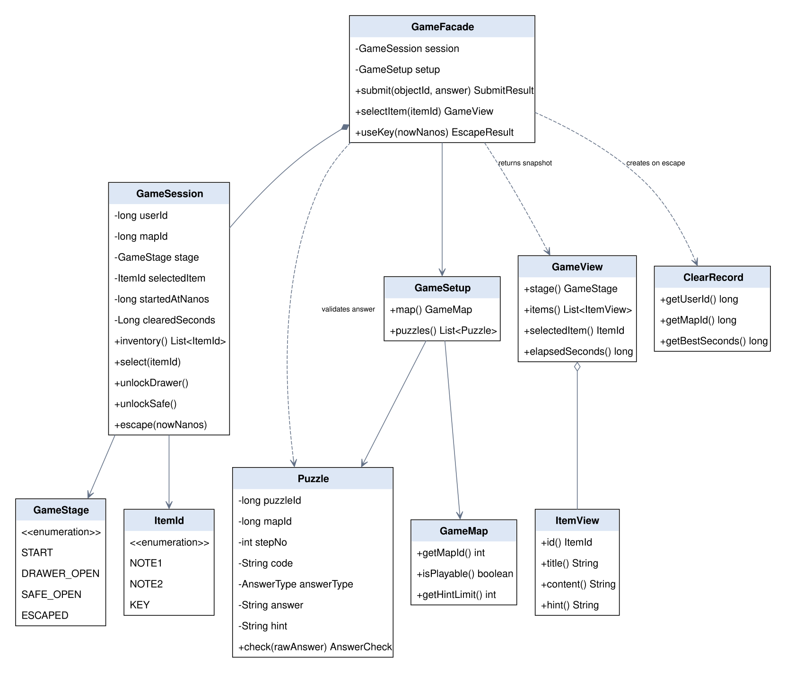
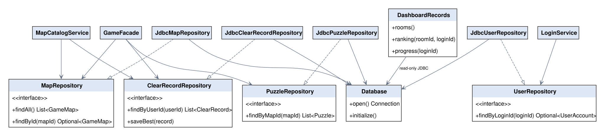
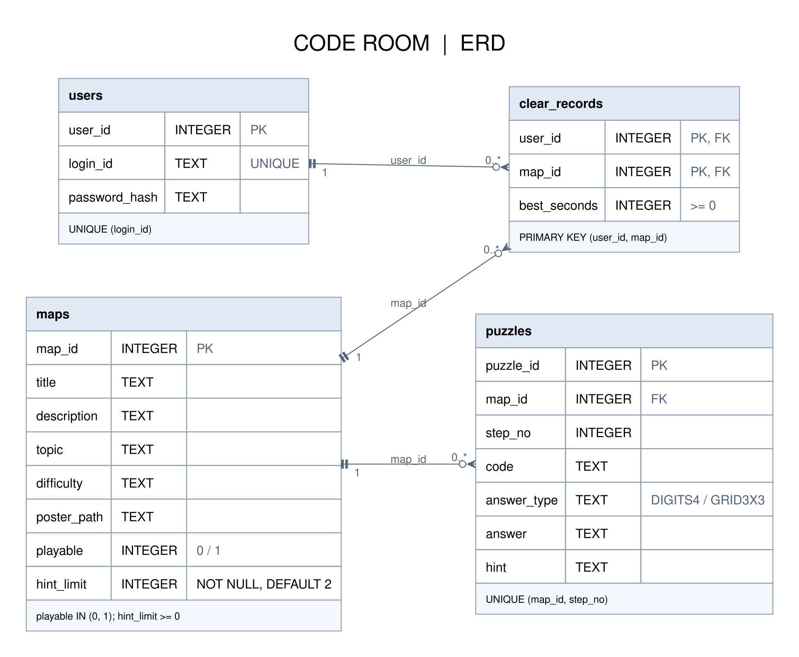
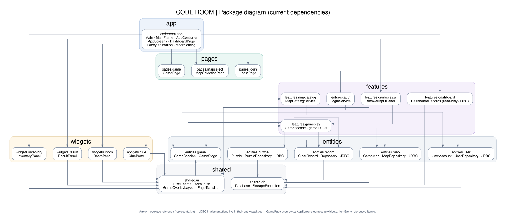
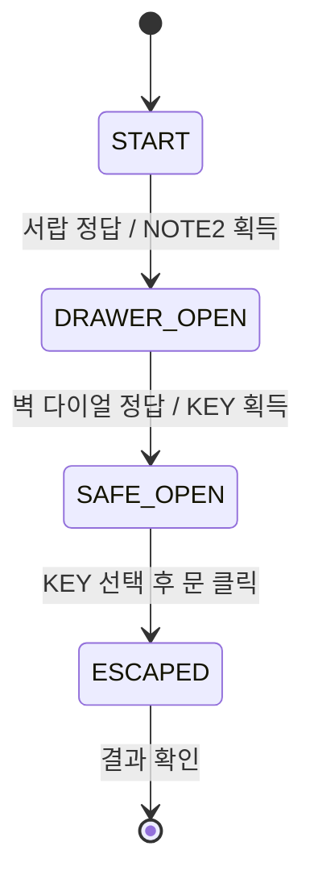
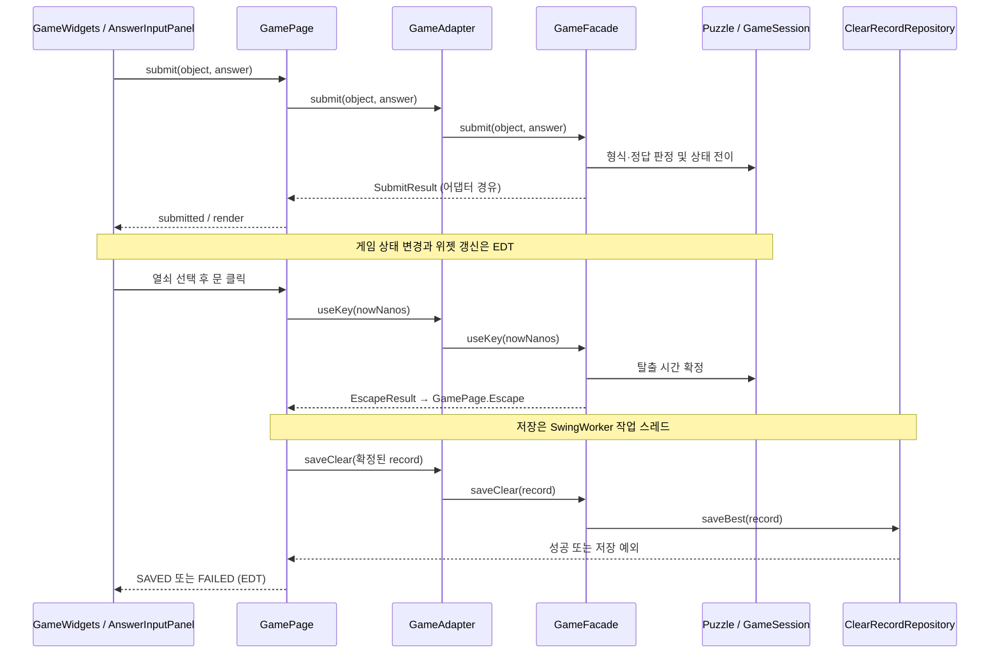

# CODE ROOM 클래스 구조 및 7인 역할 분담

기준: **2026-11-16 현재 작업 트리(미커밋 변경 포함)**. 이 문서는 현재 구현의 책임과 연결을 설명한다. 최초 일정은 [기획서](기획서.md), 수동 검증 기준은 [QA 체크리스트](QA_체크리스트.md)를 따른다.

## 구현 범위

로그인 → 픽셀 카페 로비 → 포스터형 맵 선택 → 첫 방 퍼즐 2개 → 열쇠 선택·탈출 → 최고 기록 저장이 연결되어 있다. 초기 계정은 `test`, `demo1~3` 총 4개이고 맵은 플레이 가능 1개·준비 중 2개다. 로비에서는 방별 순위와 계정별 진척도를 조회한다.

힌트는 메모별로 공개할 수 있지만 `maps.hint_limit` 차감·차단은 미구현이다. 개별 문제 풀이 이력과 진행 중 게임의 DB 저장도 없다. 진척도는 준비 중 맵을 포함한 전체 등록 맵을 기준으로 한다.

## 계층과 실제 의존 관계

| 계층 | 책임과 주요 클래스 |
| --- | --- |
| `app` | Main의 객체 조립, MainFrame, AppController, AppScreens, 로비·기록 창·애니메이션 |
| `pages` | 로그인·맵 선택 화면, GamePage의 비동기 작업·게임 수명 관리 |
| `widgets` | 방·단서·인벤토리·결과 표시와 입력 콜백 |
| `features` | 인증·맵 카드·게임 규칙 조율, 대시보드 기록 조회, 암호 입력 UI |
| `entities` | 세션·퍼즐·맵·계정·기록 모델과 저장소 계약/JDBC 구현 |
| `shared` | SQLite 초기화·저장 오류, 공통 글꼴·색·배치·이미지·전환 |

FSD 계층을 참고하되 현재 구현을 엄격한 단방향 구조로 설명하지 않는다. `DashboardRecords`는 Repository 없이 `Database`에 직접 읽기 전용 SQL을 실행하고, `shared.ui.ItemSprite`는 `entities.game.ItemId`에 의존한다.

`AppController`는 `Host`와 `Screens`에 의존한다. `MainFrame`이 Host를, `AppScreens`가 Screens를 구현한다. `AppScreens.GameAdapter`는 GamePort를 구현해 GameFacade에 위임하고, `GameWidgets`는 Widgets를 구현해 D/F/G 위젯을 조립한다. GamePage는 이 두 계약을 받아 게임 수명을 관리한다.

## 7인 역할 분담

기존 A~G 소유 범위를 유지한다. 아래 완료 조건은 담당 책임이며 수동 QA 통과 표시가 아니다.

| 담당 | 소유 범위 | 구체적인 작업과 완료 조건 |
| --- | --- | --- |
| **A** | `app/*`, `pages/game/*` | `JFrame` 하나와 `CardLayout` 구성, 로그인→대시보드→맵→게임 전환, 각 위젯 연결, `SwingWorker` 시작·완료 처리, 게임 종료 시 타이머 정리. 다른 사람의 위젯 내부를 대신 구현하지 않는다. 전체 흐름을 한 번 통과하는 통합 검증을 작성한다. |
| **B** | `pages/login/*`, `features/auth/*`, `entities/user/*` | 로그인 폼, 공백 입력·오류 안내, 비밀번호 검증, `UserRepository`와 사용자 SQL 구현. 정상/실패 로그인과 계정 구분 검증까지 맡는다. 해시 생성은 시연 계정 초기화에도 재사용하고 암호 알고리즘 자체를 만들지 않는다. |
| **C** | `pages/mapselect/*`, `features/mapcatalog/*`, `entities/map/*`, 포스터 리소스 | 포스터 3개 구성, 플레이 가능 1개/준비 중 2개 처리, 계정별 클리어·최고 기록 결합, 맵 조회 SQL. 기록을 불러온 뒤 포스터 표시가 갱신되고 준비 중 맵은 입장할 수 없어야 한다. |
| **D** | `widgets/room/*`, 방 배경·물건 리소스 | 전체 화면 방, 서랍·다이얼·문의 클릭 영역, 열린 상태 그림, 마우스 피드백, 화면 크기 변경에 따른 좌표 보정. 로직이나 DB는 맡지 않는다. 단서 종이에 핵심 물건이 가려지지 않는지 시각 검증한다. |
| **E** | `features/gameplay`의 로직·공개 DTO, `entities/game/*`, `entities/puzzle`의 모델·인터페이스 | `GameFacade`, `GameSession`, 퍼즐 형식/정답 판정, 진행 순서, 중복 보상 방지, 열쇠 선택 조건, 탈출 시간 확정. 실제 Swing·DB 없이 단위 검증 가능해야 한다. `gameplay/ui`와 JDBC 구현은 소유하지 않는다. |
| **F** | `widgets/inventory/*`, `widgets/clue/*`, `features/gameplay/ui/*` | 단서 교체·접기, 열쇠 표시, 네 자리/3×3 입력기, 힌트, 오답 메시지, 키보드 이동. UI는 입력을 모아 E의 API를 호출할 수 있도록 콜백만 전달한다. 정답을 UI에 별도로 적어 판정하지 않는다. |
| **G** | `shared/db/*`, `entities/puzzle/JdbcPuzzleRepository`, `entities/record/*`, `widgets/result/*`, 초기 SQL | SQLite 연결·테이블 생성·초기 데이터, 퍼즐 읽기, 최고 기록 저장/조회, 탈출 결과 패널. 저장 실패·재시도·더 느린 기록으로 덮어쓰기 방지를 검증한다. 사용자의 비밀번호 형식은 B와 계약하고 직접 별도 구현하지 않는다. |

추가된 로비 애니메이션 클래스는 `app` 범위다. `features/dashboard`와 `shared/ui`의 연결 책임은 [소스 구조](소스구조.md)에 기록한다. 새 공통 파일의 최종 담당은 팀에서 확정한다.

## 다이어그램

상세 원본·생성 방법은 [다이어그램 안내](diagrams/README.md)를 따른다. 클래스 그림은 주요 계약만 표시하며 모든 필드와 메서드를 나열하지 않는다. `Host`, `Screens`는 AppController의, `GamePort`, `Widgets`는 GamePage의, `GameAdapter`, `GameWidgets`는 AppScreens의 중첩 타입이다.

### 앱과 화면 조립

### 게임 도메인과 Facade

`ItemView`에는 코드/설명과 힌트만 전달한다. `GameSetup`은 로드용 맵·퍼즐 묶음으로 정답을 포함하므로 표시 DTO와 구분한다. `GameMap.getHintLimit()`은 설정 조회이며 힌트 사용량을 관리하지 않는다.

### 저장소와 JDBC

### 데이터베이스

`users.login_id`는 UNIQUE, `puzzles(map_id, step_no)`는 UNIQUE다. `clear_records`는 `(user_id, map_id)` 복합 기본키이며 더 작은 `best_seconds`만 보존한다. DB 초기화는 트랜잭션 안에서 스키마 → hint_limit 마이그레이션 → 시드를 실행한다. 기존 계정·퍼즐·기록은 시드로 덮어쓰지 않는다.

### 패키지

## 공개 API

다음 표는 현재 메서드 계약이다. `GamePage.GamePort`는 LoginUser 및 GamePage.Escape를 사용하므로 GameFacade의 호출 계약과 변환 없이 혼용하지 않는다.

| 공개 API | 입력 → 출력 | 주의할 점 |
| --- | --- | --- |
| LoginService.login | loginId, char[] password → LoginResult | 성공 시 ID와 표시용 로그인 ID만 있는 LoginUser를 반환한다. 해시는 화면에 전달하지 않는다. |
| MapCatalogService.listForUser | userId → List<MapCard> | GameMap과 해당 사용자의 ClearRecord를 결합한다. |
| GameFacade.loadMap | mapId → GameSetup | 작업 스레드에서 DB 조회. 맵 존재·playable·퍼즐 2개의 순서와 형식을 검증한다. |
| GameFacade.start | userId, setup, nowNanos → GameView | EDT에서 GameSession 생성. 플레이마다 Facade도 새로 만든다. |
| GameFacade.inspect | RoomObjectId → InspectResult | 설명, 입력창 열기 지시, 선행 조건 부족을 반환한다. 진행 상태는 바꾸지 않는다. |
| GameFacade.submit | objectId, rawAnswer → SubmitResult | WRONG / INVALID / BLOCKED / ALREADY_SOLVED / SOLVED와 표시 메시지를 반환한다. |
| GameFacade.selectItem | ItemId → GameView | 미획득 아이템은 거절한다. UI는 반환값을 그린다. |
| GameFacade.useKey | nowNanos → EscapeResult | 성공 시 GameView와 ClearRecord를 반환한다. 실패 시 이유를 반환하고 상태는 유지한다. |
| GameFacade.saveClear | ClearRecord → void | 작업 스레드에서 실행. 실패는 StorageException. GameSession에는 접근하지 않는다. |
| GameFacade.view | nowNanos → GameView | 현재 상태와 경과 시간 반환. DB 조회는 하지 않는다. |

## 게임 상태

시작 인벤토리는 NOTE1이며 선택 아이템은 없다. 메모를 선택해야 단서가 표시된다. 오답·형식 오류·선행 조건 위반은 단계를 바꾸지 않는다. `SAFE_OPEN`은 벽 다이얼을 풀어 금고에서 열쇠를 얻은 상태다. 재시작은 기존 세션을 되돌리는 대신 새 Facade·GameSession·GamePage를 만든다.

## 제출·저장 흐름과 스레드

DB 로드·인증·저장은 작업 스레드에서 수행한다. GamePage의 타이머는 250ms마다 화면 스냅샷을 갱신한다. 탈출 시간은 한 번 확정하며 저장 실패 시 동일 기록을 재시도한다. 저장 중 이동을 차단하고 미저장 이탈은 사용자 확인을 거친다. 화면 폐기 시 타이머·작업을 정리하고 늦은 콜백을 무시한다.

## 적용된 패턴과 검증

- **Facade**: GameFacade가 로드·조사·제출·선택·탈출·저장을 제공한다. 정답 판정은 Puzzle, 전이는 GameSession, SQL은 저장소에 맡긴다.
- **Adapter**: Jdbc 저장소가 도메인 Repository 계약과 SQLite 행을 연결한다. AppScreens의 어댑터는 화면 계약과 실제 서비스/위젯을 연결한다.
- Swing 이벤트와 콜백을 사용하며 별도 이벤트 버스나 상태별 클래스 계층은 두지 않는다.

자동 테스트와 실행 명령은 [테스트 가이드](Test_드라이버_가이드.md), 이번 실행 결과는 [검증 기록](검증_기록.md)에 둔다. 로비·게임의 실제 화면 품질은 별도 수동 QA 대상이다.

## 기본 테마 갱신

`seed.sql`은 이전 영문 기본 이름 또는 현재 기본 한글 이름과 일치하는 맵의 제목·설명·주제·난이도·포스터를 갱신한다. 사용자 정의 이름의 맵과 플레이 가능 여부·힌트 제한·계정·퍼즐·기록은 유지한다. 현재 기본 테마는 서재의 마지막 암호, 사라진 기록, 자정의 기계실이다.
